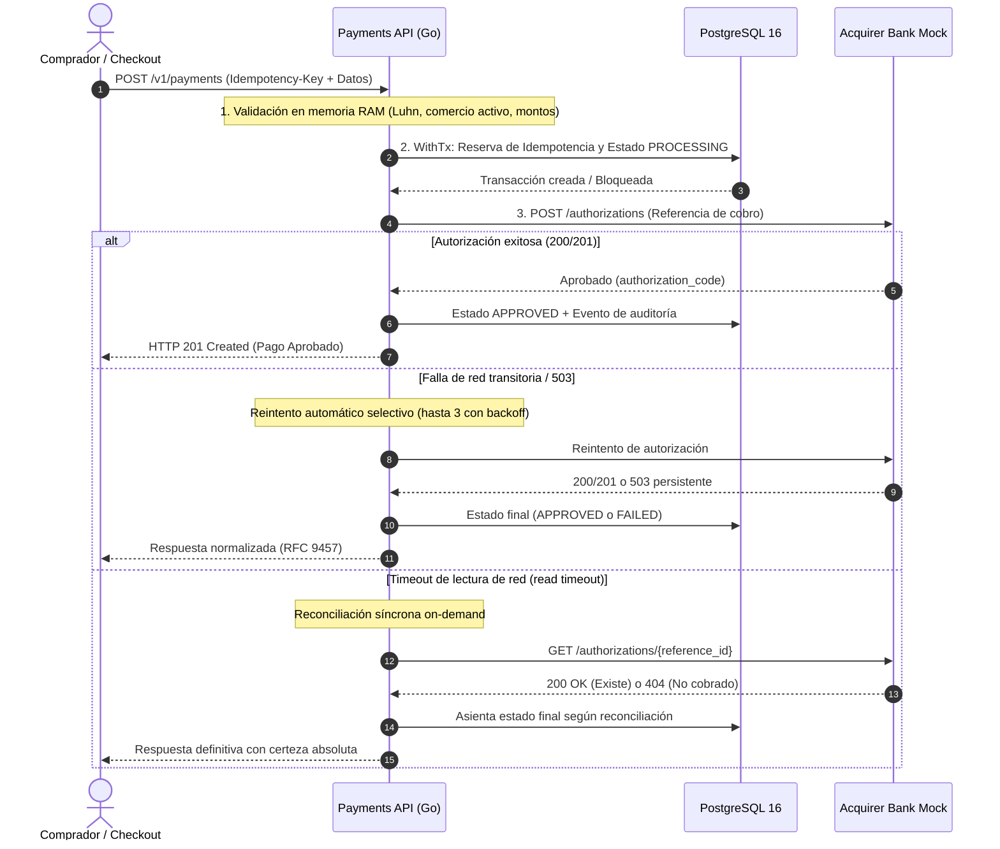
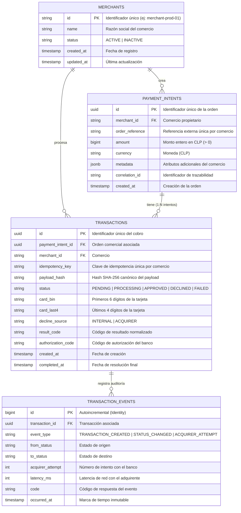
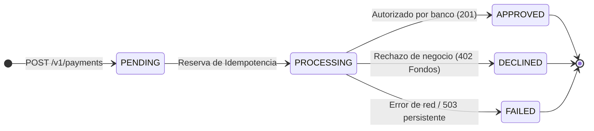
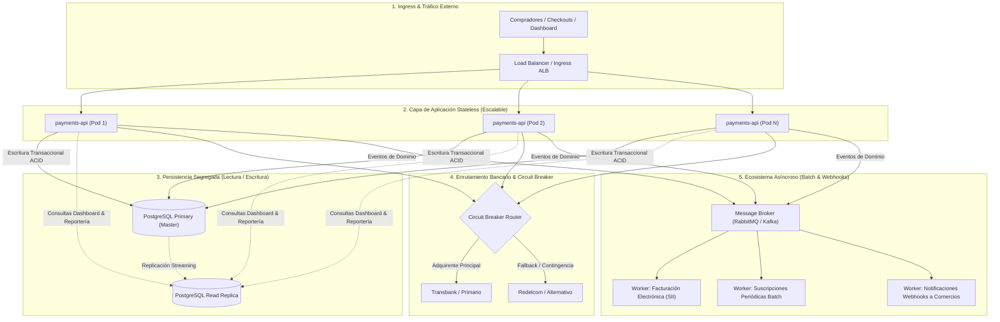

# Haulmer Payment Processing Gateway

[](https://golang.org)
[](https://www.postgresql.org)
[](https://nextjs.org)
[](https://www.docker.com)
[](https://github.com/ImSoHappi/test-haulmer/actions)
[-brightgreen?style=flat&logo=security)](https://go.dev/security/vuln/)

Sistema de Procesamiento y Autorización de Pagos con Tarjeta de Crédito y Débito para comercios chilenos en pesos (**CLP**). Diseñado con arquitectura hexagonal, principios de Domain-Driven Design (**DDD**), consistencia transaccional estricta contra dobles cobros y blindaje **PCI-DSS**.

---

## 1. Inicio Rápido (Quickstart en 1 Minuto)

Todo el ecosistema (Base de datos PostgreSQL, Simulador Bancario, API de Pagos y Panel Web) está completamente contenerizado y configurado para levantarse con **un solo comando**.

### Requisitos Previos
- **Docker** y **Docker Compose** instalados y en ejecución.
- Herramienta **Make** (opcional, pero recomendada para desarrollo rápido).

### Ejecución
```bash
# 1. Clonar el repositorio
git clone https://github.com/ImSoHappi/test-haulmer.git
cd test-haulmer

# 2. Levantar todo el stack en segundo plano
make up
# (o directamente con Docker: docker compose up --build -d)
```

### Servicios Disponibles Localmente

| Servicio | URL | Descripción |
| :--- | :--- | :--- |
| **Panel Web & Sandbox** | [http://localhost:3000](http://localhost:3000) | Dashboard de transacciones en tiempo real y simulador interactivo de pagos. |
| **Payments REST API** | [http://localhost:8080](http://localhost:8080) | Servicio central de pagos (`POST /v1/payments`, `GET /health`). |
| **Acquirer Bank Mock** | [http://localhost:8081](http://localhost:8081) | Simulador bancario independiente con comportamiento determinista. |
| **PostgreSQL Database** | `localhost:5432` | Base de datos relacional con migraciones automáticas (`payments_db`). |

---

## 2. Comandos de Automatización (`Makefile`)

El proyecto cuenta con un `Makefile` limpio y autodocumentado para gestionar el ciclo de vida, calidad y seguridad:

| Comando | Responsabilidad |
| :--- | :--- |
| `make up` | Construye y levanta los 4 contenedores en segundo plano (`docker compose up --build -d`). |
| `make down` | Detiene los servicios y destruye contenedores y volúmenes (`docker compose down -v`). |
| `make logs` | Visualiza los logs estructurados unificados en tiempo real (`docker compose logs -f`). |
| `make status` | Consulta el estado de salud de cada contenedor (`docker compose ps`). |
| `make test` | Ejecuta las pruebas unitarias e integración en Go con detector de carreras (`go test -v -race ./...`). |
| `make test-e2e` | Ejecuta la suite de pruebas End-to-End contra los 7 escenarios bancarios deterministas. |
| `make complexity` | Audita la mantenibilidad del código: Complejidad Ciclomática ($\le 15$) y Cognitiva ($\le 20$). |
| `make security` | Escaneo exhaustivo de CVEs y vulnerabilidades con `govulncheck` en Go y `npm audit` en Next.js. |
| `make lint` | Análisis estático estricto con `go vet` en backend y `ESLint` en frontend. |
| `make format` | Formatea el código fuente Go automáticamente (`gofmt -s -w`). |

---

## 3. Panel Web Operativo: Monitoreo, Auditoría y Simulación

El proyecto incorpora un panel de control interactivo construido en **Next.js 15 (App Router)** y **React 19** ([http://localhost:3000](http://localhost:3000)), concebido como una herramienta para el análisis de transacciones, observabilidad forense del ciclo de vida y simulación controlada de pagos.

### 3.1 Vistas y Opciones de la Aplicación

1. **Dashboard en Tiempo Real (`/`):**
   - **Métricas Consolidadas:** Tarjetas de resumen con el volumen total procesado en CLP, total de pagos registrados y desglose por estado (`APPROVED`, `DECLINED`, `FAILED`).
   - **Tabla Paginada de Transacciones:** Listado con filtrado instantáneo por estado y paginación acotada (`LIMIT` / `OFFSET`). Permite ver el identificador de transacción, referencia de orden, tarjeta enmascarada (`424242******4242`), monto, resultado y fecha.
   - **Aislamiento Multi-Comercio:** Selector en la barra de navegación para alternar entre comercios (`Comercio 1001` vs `Comercio 1002`) y verificar que ningún comercio pueda visualizar transacciones ajenas.
   - **Server-Side Rendering (SSR):** Carga inicial directamente en el servidor para máxima velocidad y resiliencia ante fallos de red.

2. **Línea de Tiempo Forense (`/payments/[id]`):**
   - **Trazabilidad Inmutable:** Al hacer clic en cualquier transacción, se despliega la cronología completa de eventos de auditoría (`TRANSACTION_CREATED`, `STATUS_CHANGED`, `ACQUIRER_ATTEMPT`).
   - **Diagnóstico Bancario:** Visualización de latencia bancaria en milisegundos, código de autorización (`authorization_code`), códigos de rechazo bancario (`51`, etc.) y correlación de trazabilidad (`X-Correlation-ID`).

3. **Simulador de Pagos & Sandbox (`/sandbox`):**
   - **Entorno de Pruebas:** Formulario de checkout interactivo para disparar pagos reales contra la pasarela, con generación automática de orden comercial y clave de idempotencia única.
   - **Validación de Idempotencia:** Incluye un control para *"Repetir clave de idempotencia anterior"*, permitiendo validar en vivo la respuesta `Idempotent-Replayed: true` (HTTP 200) sin duplicar cargos ni llamar nuevamente al banco.
   - **Arquitectura Backend-for-Frontend (BFF):** Los pagos desde el simulador se envían mediante **Server Actions** de Next.js, evitando exponer la red interna de la API o variables privadas al navegador.

### 3.2 Catálogo de Tarjetas Deterministas de Prueba

Para probar el comportamiento del sistema ante diferentes respuestas bancarias y reglas de negocio, el simulador cuenta con precarga en un clic de 7 tarjetas deterministas:

| Escenario | PAN de Prueba | Código HTTP / Estado | Comportamiento Técnico & Bancario |
| :--- | :--- | :--- | :--- |
| **Aprobada** | `4242 4242 4242 4242` | `201 Created` / `APPROVED` | Flujo exitoso estándar. El banco autoriza inmediatamente y genera código de autorización. |
| **Fondos Insuficientes** | `4000 0000 0000 9995` | `402 Payment Required` / `DECLINED` | Rechazo determinista con código bancario `51`. No genera reintentos inútiles. |
| **Falla Intermitente (503)** | `4000 0000 0000 0341` | `201 Created` / `APPROVED` | Simula caída en intentos 1 y 2. La API reintenta con backoff exponencial y recupera la aprobación al 3er intento. |
| **Caída Sostenida (503)** | `4000 0000 0000 0119` | `503 Service Unavailable` / `FAILED` | Falla persistente del adquirente. La API agota sus 3 reintentos y corta de forma segura. |
| **Timeout sin Autorización** | `4000 0000 0000 0101` | `504 Gateway Timeout` / `FAILED` | El banco excede el tiempo límite de lectura. La API reconcilia síncronamente (`GET /authorizations/{ref}`), recibe 404 y asienta falla segura. |
| **Timeout con Autorización** | `4000 0000 0000 0259` | `201 Created` / `APPROVED` | Timeout de lectura. La API reconcilia en caliente, detecta que el banco sí alcanzó a cobrar, y recupera la aprobación evitando cobros duplicados. |
| **Anti-Carding (Luhn Inválido)** | `4242 4242 4242 4241` | `422 Unprocessable Entity` | Dígito verificador de tarjeta inválido. Falla en memoria en el umbral HTTP sin tocar la base de datos. |

### 3.3 Verificación Automatizada por Consola
Como alternativa al flujo visual, el proyecto incluye una suite de pruebas End-to-End ejecutable por terminal:
```bash
make test-e2e
```
Este script recorre automáticamente los 7 escenarios anteriores realizando peticiones HTTP reales contra el gateway, certificando las respuestas esperadas, las cabeceras de idempotencia y el aislamiento multi-tenant.

---

## 4. Arquitectura del Sistema, Supuestos y Decisiones Técnicas

Al abordar este desafío, mi objetivo principal no fue solo construir un servicio que procesara pagos, sino diseñar una solución de grado bancario que otorgue **certeza y confianza absoluta**: que garantice matemáticamente que jamás ocurrirá un cobro doble, que sea altamente tolerante a caídas de red y que cualquier persona (desarrollador, soporte o negocio) pueda auditar cada paso con total transparencia.

---

### 4.1. El Punto de Partida: Definición de Producto y Requerimientos (PRD)

Antes de escribir la primera línea de código, decidí no saltar directo a la implementación, sino estructurar el desafío desde la perspectiva de producto: responder con claridad el **¿Para qué?** y el **¿Por qué?**.

Todo el alcance fue formalizado en el documento [docs/prd.md](docs/prd.md). Una pasarela de pagos vive o muere por la confianza:
- El **comercio** necesita saber con certeza si la venta fue cobrada.
- El **usuario final** necesita una respuesta clara e inmediata en su pantalla, sin estados ambiguos.
- La **plataforma** debe asegurar que, ante cualquier fallo de red, corte de conexión o doble clic en el botón de pago, el dinero del comprador esté protegido.

---

### 4.2. Supuestos de Negocio y Decisiones de Ingeniería

Para transformar los requerimientos en una arquitectura técnica sólida, partí de una serie de supuestos prácticos y tomé decisiones de ingeniería orientadas a la certeza y la simplicidad.

#### Flujo de Secuencia del Procesamiento Síncrono

El siguiente diagrama detalla el ciclo de vida completo de un pago, desde la validación en memoria hasta la resolución bancaria y los mecanismos de resiliencia:



#### Supuestos y Decisiones de Arquitectura

- **Supuesto: Experiencia de Checkout Síncrona e Interactiva**
  - *Contexto:* Asumí que los comercios operan bajo un flujo de compra interactivo: el comprador hace clic en *"Pagar"* y espera frente a la pantalla la confirmación en tiempo real de su transacción.
  - *Decisión:* Diseñé la API para procesar de forma **síncrona** en el ciclo de vida de la petición HTTP. Esto ofrece retroalimentación inmediata al comprador y evita la sobreingeniería de colas o mecanismos de sondeo continuo (*polling*) en el frontend.
  - *Impacto en Seguridad (PCI-DSS):* Al procesar de forma síncrona, los datos confidenciales de la tarjeta (el PAN de 16 dígitos y el código CVV) residen **únicamente en la memoria volátil (RAM)** de la petición durante los milisegundos que toma comunicarse con el banco. Nunca se escriben en disco ni en almacenamiento temporal, reduciendo al mínimo la superficie de ataque y el alcance de auditoría.

- **Decisión: Garantía de No Doble Cobro en Tres Niveles de Defensa**
  El mayor riesgo en un procesador de pagos es cobrar dos veces una misma orden (por ejemplo, si el comprador presiona el botón dos veces por impaciencia o sufre una intermitencia de red). Para blindar el sistema, implementé tres barreras complementarias:
  1. *Nivel HTTP / Criptográfico (Idempotencia):* Cada solicitud exige una cabecera `Idempotency-Key`. La API genera un hash criptográfico SHA-256 de los datos canónicos (`merchant_id`, `order_reference`, `amount`, `card_bin`, `card_last4`). Si la misma petición llega duplicada, se devuelve la respuesta original almacenada en caché con la cabecera `Idempotent-Replayed: true` (HTTP 200) sin volver a cobrar ni molestar al banco. Si alguien reutiliza la clave para enviar un monto o datos alterados, se rechaza de inmediato con HTTP 409 Conflict (`idempotency_conflict`).
  2. *Nivel de Aplicación (`HasApprovedTransaction`):* Antes de enviar cualquier mensaje al adquirente bancario, el servicio consulta si la orden comercial ya cuenta con una transacción aprobada. Si ya fue pagada con éxito, la ejecución se detiene de inmediato con HTTP 409 (`intent_already_approved`), previniendo cargos duplicados a la tarjeta del cliente.
  3. *Nivel Físico en PostgreSQL (Última Línea de Defensa):* Si dos solicitudes simultáneas lograran cruzar la aplicación en una condición de carrera extrema, la base de datos lo bloquea físicamente mediante índices parciales únicos:
     - `uq_tx_idempotency`: Evita colisiones de clave por comercio.
     - `uq_tx_one_approved`: Garantiza a lo sumo una transacción `APPROVED` por orden comercial.
     - `uq_tx_one_active`: Limita a una sola transacción en curso (`PENDING` o `PROCESSING`) a la vez.

- **Decisión: Validaciones Tempranas en Umbral HTTP (Anti-Carding y Ahorro)**
  - Validaciones de formato como el algoritmo de Luhn (dígito verificador de la tarjeta), fecha de expiración, montos enteros válidos en CLP y verificación del estado activo del comercio se ejecutan **en memoria en el handler HTTP**, antes de iniciar transacciones en la base de datos o llamar al banco.
  - Si un usuario ingresa una tarjeta con numeración inválida o vencida, se retorna de inmediato HTTP 422 Unprocessable Entity. Esto mitiga ataques automatizados de prueba de tarjetas (*carding*), protege el pool de conexiones de PostgreSQL y evita registrar basura innecesaria en la base de datos.

- **Decisión: Resiliencia ante Fallas del Adquirente (Reintentos Selectivos)**
  - Si el adquirente bancario sufre una caída transitoria de infraestructura (`503 Service Unavailable` o fallo de red), la API reintenta automáticamente hasta 3 veces aplicando retroceso exponencial (*exponential backoff*) y fluctuación aleatoria (*jitter*) para no saturar al servidor.
  - Los reintentos son **estrictamente selectivos**: ante rechazos de negocio definitivos (`DECLINED` por fondos insuficientes o tarjeta expirada) o errores de validación (`400`, `422`), la API **nunca reintenta**, protegiendo al sistema de ciclos inútiles.

- **Decisión: Recuperación On-Demand ante Timeouts (Sin Daemons ni Cronjobs)**
  - Si una llamada al adquirente supera el tiempo límite de espera (*read timeout*), no sabemos si el banco cobró o no antes del corte.
  - En lugar de esperar a un proceso en segundo plano o cronjob nocturno, la API ejecuta una **reconciliación síncrona on-demand**: en esa misma petición, consulta de inmediato `GET /authorizations/{reference_id}` al simulador. Si el banco confirma que la operación se registró, se aprueba localmente; si responde 404, se marca como fallida de forma segura.

- **Decisión: Protección ante Desconexión del Comprador (`context.WithoutCancel`)**
  - Si un comprador pierde señal en su teléfono o cierra el navegador mientras el banco está procesando la solicitud, el contexto HTTP del cliente se cancela.
  - Para evitar que la transacción quede en un estado huérfano a mitad de camino, la API desacopla la comunicación bancaria y la persistencia en base de datos mediante `context.WithoutCancel(ctx)`, asegurando que la operación termine de registrar su estado final de manera consistente.

- **Decisión: Trazabilidad Completa y Cero Filtraciones en Logs**
  - **Identificadores Correlacionados:** Se mantiene trazabilidad de punta a punta vinculando la orden comercial (`order_reference`), la clave de deduplicación (`idempotency_key`), el identificador del gateway (`transaction_id`) y el identificador bancario (`acquirer_reference_id`).
  - **Línea de Tiempo Forense:** Cada cambio de estado genera un evento inmutable registrado con marca temporal (`PAYMENT_REQUESTED`, `IDEMPOTENCY_LOCKED`, `ACQUIRER_SENT`, `ACQUIRER_TIMEOUT`, `RECONCILED`, `PAYMENT_APPROVED`), visible en el dashboard para soporte técnico y auditoría.
  - **Logs Seguros (Zero-Leak):** Registro en formato JSON estructurado con `log/slog`. Los tipos de tarjeta implementan las interfaces `slog.LogValuer` y `fmt.Stringer`, garantizando que el PAN se imprima siempre enmascarado (`424242******4242`) y el CVV jamás figure en logs.

---

### 4.3. Modelo de Base de Datos en PostgreSQL y Razonamiento

Diseñé el esquema relacional pensando en la realidad operativa del comercio electrónico: consistencia transaccional, auditoría y aislamiento multi-comercio.

#### Diagrama Entidad-Relación (ER)



#### Decisiones Clave del Esquema

- **Separación de `payment_intents` (Orden Comercial) y `transactions` (Intentos de Cobro 1:N):**
  - *Problema Real:* En el comercio electrónico, un cliente puede intentar pagar una compra de $15.000 y ser rechazado en un primer intento (por ejemplo, fondos insuficientes o tarjeta expirada). En vez de obligarlo a recrear el carrito de compras, el comercio le permite reintentar con otra tarjeta sobre la **misma orden de compra**.
  - *Decisión:* Separar la *intención de pago* (`payment_intents`, con su monto y moneda) de las *transacciones individuales* (`transactions`, cada intento técnico de cobro). Esto permite registrar el historial forense de cada intento fallido sin perder la trazabilidad de la orden.
  - *Garantía Física:* Para evitar que una orden se cobre dos veces, PostgreSQL aplica el índice parcial único:
    ```sql
    CREATE UNIQUE INDEX uq_tx_one_approved ON transactions (payment_intent_id) WHERE status = 'APPROVED';
    ```
    Esto asegura a nivel de motor de base de datos que, sin importar cuántos intentos ocurran o si dos peticiones llegan concurrentemente, **jamás existirá más de una transacción aprobada por orden**.

- **Aislamiento Multi-Tenant con `merchants`:**
  - Cada comercio cuenta con su propio registro y estado operativo (`active: true/false`). Si un comercio es suspendido, el gateway rechaza cualquier operación entrante en el umbral HTTP sin tocar transacciones financieras.

- **Deduplicación Criptográfica en `transactions`:**
  - Se almacena el par `(merchant_id, idempotency_key)` junto con el hash criptográfico SHA-256 (`payload_hash`) de los datos de la petición.
  - El índice único `uq_tx_idempotency` previene colisiones en la base de datos, mientras que la verificación del hash detecta reintentos con parámetros alterados retornando HTTP 409 Conflict.

- **Auditoría Forense con `transaction_events`:**
  - Tabla inmutable que almacena la traza cronológica de cada cobro: creación de la transacción, intentos hacia el adquirente con su latencia en milisegundos (`latency_ms`) y transiciones de estado, alimentando directamente la vista forense del dashboard.

#### Campos Especiales y su Propósito Técnico

Para asegurar integridad, seguridad PCI y soporte operacional, incluí ciertos campos clave cuyo propósito conviene destacar:

| Campo | Ubicación | Propósito y Uso Técnico |
| :--- | :--- | :--- |
| **`idempotency_key`** | `transactions` | **Garantía anti-duplicados:** Identificador único enviado por el cliente. Si la conexión se interrumpe y el cliente reenvía la petición con la misma clave, la API reconoce que ya fue procesada y devuelve la respuesta en caché (`Idempotent-Replayed: true`) sin volver a cobrar. |
| **`payload_hash`** | `transactions` | **Huella digital de integridad:** Hash SHA-256 calculado a partir de los datos canónicos de la compra (`merchant_id`, `order_reference`, `amount`, `card_bin`, `card_last4`). Si alguien reutiliza una clave existente pero altera el monto o la tarjeta, la API detecta el conflicto y rechaza con `409 Conflict`, impidiendo cobros indebidos. |
| **`correlation_id`** | `payment_intents`, `transactions`, `events` | **Trazabilidad de punta a punta:** Identificador UUID (propagado vía cabecera `X-Correlation-ID`) que conecta todo el ciclo de vida. Permite cruzar en segundos los logs del servidor (`slog`), las consultas en PostgreSQL y los eventos bancarios ante cualquier reclamo o investigación. |
| **`card_bin` y `card_last4`** | `transactions` | **Cumplimiento estricto PCI-DSS:** Por normativa de seguridad bancaria, el número de tarjeta completo (16 dígitos) y el CVV **nunca se guardan en base de datos**. Al guardar solo los primeros 6 dígitos (identifican banco emisor) y los últimos 4, permitimos que el comercio y el comprador reconozcan la tarjeta (`424242******4242`) sin exponer datos sensibles. |

---

### 4.4. Diseño de Software: Arquitectura Hexagonal y DDD

Estructuré el microservicio `payments-api` siguiendo los principios de **Arquitectura Hexagonal (Puertos y Adaptadores)** y **Domain-Driven Design (DDD)** para aislar la lógica de negocio de los detalles de infraestructura:

#### Máquina de Estados de la Transacción



#### Capas de la Arquitectura

- **Dominio Puro (`internal/domain/`):**
  El núcleo del sistema, completamente libre de SQL, HTTP o librerías externas. Contiene las entidades (`Transaction`, `PaymentIntent`, `Merchant`), los objetos de valor (`Amount`, `CardNumber`) y la máquina de estados. Los tipos sensibles implementan auto-enmascaramiento para evitar filtraciones de tarjeta.
- **Aplicación (`internal/payment/`):**
  Casos de uso coordinados (`ProcessPayment`, `GetPayment`, `ListPayments`) que orquestan los flujos de negocio mediante interfaces limpias (*puertos* como `Repository` y `AcquirerClient`).
- **Adaptadores (`internal/http/`, `internal/postgres/`, `internal/acquirer/`):**
  - *Adaptador Primario (HTTP):* Rutas nativas sobre `net/http.ServeMux` de Go 1.22+ sin frameworks pesados, con manejo de errores centralizado bajo el estándar **RFC 9457** (`application/problem+json`).
  - *Adaptadores Secundarios:* PostgreSQL gestionado con `pgxpool` y cliente HTTP del adquirente con reintentos y reconciliación.

Gracias a este desacople, sustituir el simulador bancario por un adquirente real (como Transbank, Redelcom o Stripe) requiere únicamente implementar una nueva versión del adaptador `AcquirerClient`, **sin modificar una sola línea de código del dominio ni de la aplicación**.

---

## 5. Por qué la Decisión de Monorepo (Pragmatismo de MVP)

Para el alcance de este desafío, opté conscientemente por una estructura de **Monorepo** por razones de eficiencia, velocidad de desarrollo y simplicidad operativa:

1. **Eliminación de Fricción en el MVP:**
   En un sistema compuesto por 3 piezas funcionales (`payments-api`, `acquirer-mock`, `web-dashboard`), separar los proyectos en múltiples repositorios habría generado sobrecostos innecesarios: sincronización manual de contratos, gestión de múltiples ramas y pipelines de CI fragmentados.
2. **Orquestación y Pruebas Atómicas:**
   Permite que la orquestación (`docker-compose.yml`), la automatización (`Makefile`), la suite de pruebas E2E (`scripts/test-e2e.sh`) y el pipeline de CI en GitHub Actions residan en un único lugar, verificando todo el sistema con un solo comando.
3. **Cero Compromiso en Escalabilidad:**
   Tener el código en un monorepo no limita la escalabilidad operativa:
   - Cada componente cuenta con su propio `Dockerfile` multi-stage independiente y aislado.
   - El servicio `payments-api` es **100% Stateless**, lo que permite desplegar múltiples réplicas del contenedor en producción detrás de un balanceador de carga, comunicándose con PostgreSQL sin depender del dashboard ni del mock.

---

## 6. Estructura del Repositorio

```text
.
├── .github/workflows/ci.yml       # Pipeline CI en GitHub Actions (paralelo y ligero)
├── Makefile                       # Automatización de tareas de desarrollo y calidad
├── docker-compose.yml             # Orquestación de Postgres, Mock, API y Dashboard
├── .env.example                   # Plantilla de variables de entorno estandarizada
├── docs/                          # Documentación técnica y trazabilidad de requerimientos
│   ├── prd.md                     # Documento de Requerimientos de Producto (PRD)
│   ├── technical-design.md        # Documento de Diseño Técnico de Arquitectura
│   ├── backlog-improvements.md    # Registro de deuda técnica controlada y mejoras futuras
│   └── tasks/                     # Desglose metodológico de las 10 tareas del proyecto
├── payments-api/                  # Servicio central de procesamiento de pagos (Go 1.25+)
│   ├── cmd/api/main.go            # Composition Root y apagado ordenado (Graceful Shutdown)
│   ├── internal/domain/           # Núcleo de Dominio puro (Entidades, VO, Máquina de Estados)
│   ├── internal/payment/          # Capa de Aplicación (Servicios, DTOs y Puertos)
│   ├── internal/http/             # Adaptador Primario (Handlers HTTP, Router, RFC 9457)
│   ├── internal/postgres/         # Adaptador Secundario (pgxpool, Repositorio, Migraciones)
│   └── internal/acquirer/         # Adaptador Secundario (Cliente HTTP con backoff y reconciliación)
├── acquirer-mock/                 # Simulador bancario independiente (Go 1.25+)
│   ├── cmd/mock/main.go           # Punto de entrada del mock bancario
│   └── internal/handler/          # Lógica de simulación determinista según PAN
├── web-dashboard/                 # Panel web de evaluación y Sandbox (Next.js 15, React 19)
│   ├── src/app/                   # App Router, Dashboard SSR y Sandbox con Server Actions
│   └── src/components/            # Componentes UI (Tabla de pagos, EventTimeline forense)
└── scripts/
    └── test-e2e.sh                # Suite automatizada de pruebas End-to-End (7 escenarios)
```

---

## 7. Transparencia en el Uso de Inteligencia Artificial & Trazabilidad en `docs/`

Este proyecto se desarrolló utilizando asistentes de Inteligencia Artificial como un **compañero de pair programming técnico**.

### Trazabilidad Completa en `docs/`
Todo el proceso de refinamiento, especificación y toma de decisiones se encuentra documentado y versionado en el repositorio:
- [docs/prd.md](docs/prd.md): Especificación de producto, reglas de negocio y alcance.
- [docs/technical-design.md](docs/technical-design.md): Diseño técnico de arquitectura, contratos de datos y mitigaciones de seguridad.
- [docs/tasks/](docs/tasks/): Desglose paso a paso de las 10 tareas de ingeniería ejecutadas bajo el protocolo TDD.

### Cómo se Utilizó la IA y Dónde Aportó el Criterio Humano
- **Generación Acelerada de Boilerplate y Tests:** La IA asistió en la creación de esqueletos de código, estructuras de prueba unitaria y generación de mocks HTTP para los tests de integración.
- **Refactorización de Calidad y Complejidad:** Se utilizó para identificar funciones de alta densidad y refactorizarlas en métodos cohesivos, logrando que el 100% del código cumpla con los umbrales estrictos de **Complejidad Ciclomática $\le 15$** (`gocyclo`) y **Complejidad Cognitiva $\le 20$** (`gocognit`).
- **Criterio de Ingeniería Humano:**
  - *Eliminación de defaults mágicos:* Se rechazaron fallbacks silenciosos como `http://localhost:8081` en favor de un diseño *fail-fast* estricto donde variables como `PORT` o `DATABASE_URL` son obligatorias al iniciar.
  - *Consistencia transaccional:* Se diseñó la frontera de aislamiento `WithTx` para que la transacción de base de datos se confirme antes de llamar al banco, evitando que las conexiones de PostgreSQL queden retenidas durante la latencia de red (*connection pool starvation*).
  - *Mitigación anti-doble cobro:* Se implementó la verificación `HasApprovedTransaction` para evitar llamar al adquirente si una orden ya fue pagada.

---

## 8. Visión a Futuro y Plan de Escalabilidad Productiva

El sistema fue diseñado intencionalmente como un **MVP sólido, desacoplado y sin sobreingeniería**. La base arquitectónica actual soporta altos volúmenes de transacción sin necesidad de rediseñar componentes.

### Arquitectura Objetivo para Alta Concurrencia



### Plan de Evolución Técnica

Para llevar este servicio a un entorno de producción a escala nacional en Haulmer, el plan de evolución contempla:

1. **Escalamiento Horizontal Stateless:**
   Al no guardar estado en memoria local, el servicio `payments-api` se escala simplemente aumentando el número de réplicas detrás de un balanceador de carga (como AWS ALB o Nginx).
2. **Optimización de Base de Datos:**
   Incorporación de réplicas de lectura (*Read Replicas*) en PostgreSQL para derivar las consultas de reportería y filtros del dashboard (`GET /v1/payments`), reservando el nodo primario exclusivamente para escrituras transaccionales ACID de cobro.
3. **Resiliencia Multi-Adquirente & Circuit Breakers:**
   Evolución del adaptador `acquirer` para soportar múltiples procesadores bancarios con enrutamiento inteligente y patrón Circuit Breaker, derivando transacciones a adquirentes secundarios si el principal sufre una caída sostenida.
4. **Observabilidad Distribuida:**
   Integración de exportadores OpenTelemetry / Prometheus para métricas de latencia bancaria percentil (p95, p99) y trazabilidad distribuida de extremo a extremo.
5. **Webhooks Asíncronos hacia Comercios:**
   Envío de notificaciones HTTP firmadas criptográficamente hacia los comercios ante cambios de estado de transacción, complementando el flujo síncrono inicial.
6. **Procesamiento Asíncrono para Procesos Batch (Facturación y Suscripciones):**
   Si el modelo de negocio incorpora servicios que no requieren interacción síncrona inmediata — como la emisión diferida de facturas electrónicas o el cobro automático de suscripciones recurrentes — estos flujos se delegarían a colas de mensajería (RabbitMQ / Kafka) y workers en segundo plano. Esto permite procesar cobros periódicos en lotes (*batch*) y gestionar documentos tributarios sin competir por recursos ni afectar la latencia del checkout en tiempo real.