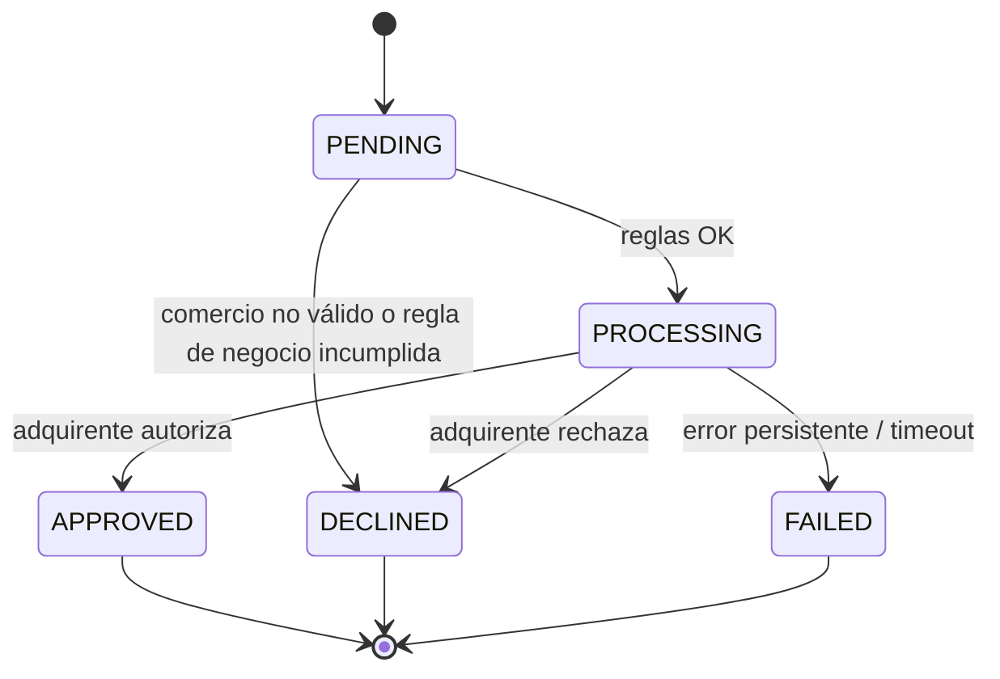

# PRD: Payment Processing Service

- **Status:** Draft
- **Last updated:** 2026-10-22

## Overview

El **Payment Processing Service** es el componente de una plataforma de pagos que recibe solicitudes de cobro de múltiples **comercios**, las valida, aplica reglas de negocio y consulta a un **adquirente externo** para autorizar o rechazar cada pago. Deja además un registro trazable de todo el proceso. Está pensado para que los **comercios** cobren con seguridad y sin duplicados, y para que **operaciones/soporte** puedan auditar qué pasó con cada transacción.

No pretende ser una pasarela completa: es un **núcleo transaccional correcto, trazable y evolucionable**.

## Problem

Procesar pagos tiene dolores concretos si el componente central no está bien resuelto:

| Dolor | Consecuencia |
| :--- | :--- |
| Los comercios reintentan solicitudes (timeouts, doble clic, fallos de red) | **Cobros duplicados** al tarjetahabiente |
| El adquirente falla de forma temporal | Pagos perdidos o en estado incierto: no se sabe si se cobró |
| No hay historial de cada pago | No se puede auditar, dar soporte ni resolver disputas |
| Reglas de negocio ausentes o dispersas | Transacciones inválidas o riesgosas llegan al adquirente |
| Datos de tarjeta mal manejados | Riesgo de seguridad y de cumplimiento (PCI-DSS) |

## Goals

- **G1.** Procesar un pago de punta a punta: recibir → validar → autorizar → responder al comercio.
- **G2.** Garantizar que una misma intención de pago **nunca se cobre dos veces**.
- **G3.** Que **toda transacción sea auditable**: saber qué pasó, cuándo y por qué.
- **G4.** Tolerar fallos temporales del adquirente sin perder ni duplicar transacciones.
- **G5.** Permitir **consultar** el estado de las transacciones por identificador, comercio y estado, tanto por API como desde una vista web básica.

## Non-goals

- Autenticación/autorización real de comercios (API keys, OAuth).
- Liquidación, conciliación, contracargos, reembolsos y anulaciones.
- Tokenización real de tarjetas / vault PCI-compliant.
- Integración con un adquirente real: solo un **Acquirer Mock**.
- Multi-región, alta disponibilidad real y escalado horizontal probado.
- Administración de comercios (alta, baja, edición): los comercios y su información básica se asumen precargados.
- 3-D Secure, wallets, transferencias u otros medios distintos de tarjeta.

## Requirements / User stories

### Conceptos clave

| Concepto | Definición |
| :--- | :--- |
| **Intención de pago** | Lo que el comercio quiere cobrar a un cliente (comercio, monto y moneda). Puede tener varios intentos, pero **a lo sumo uno aprobado**. Se considera pagada cuando uno de sus intentos queda `APPROVED`. |
| **Transacción (intento de pago)** | Cada intento de cobrar una intención ante el adquirente. Tiene su propio estado (`PENDING`, `PROCESSING`, `APPROVED`, `DECLINED`, `FAILED`) y su propio historial. |
| **Clave de idempotencia** | Identificador único que el comercio envía en cada solicitud de intento. Repetirla nunca genera un segundo intento ni un segundo cobro. |

### Creación de pagos

| ID | Historia |
| :--- | :--- |
| R1 | Como **comercio**, quiero enviar una solicitud de pago con `merchant_id`, monto, moneda y datos de tarjeta, para cobrar a mi cliente (`POST /payments`). |
| R2 | Como **comercio**, quiero que mis datos se validen antes de procesar, para recibir un error claro si algo está mal sin que se cree una transacción. |
| R3 | Como **comercio**, quiero conocer el resultado final del pago (aprobado, rechazado o fallido), para informar a mi cliente. |
| R4 | Como **operador**, quiero que cada pago válido genere una transacción con estado inicial `PENDING`, para tener registro desde el primer momento. |
| R5 | Como **plataforma**, quiero aplicar reglas de negocio básicas antes de contactar al adquirente, para no enviar pagos inválidos o riesgosos. |
| R6 | Como **plataforma**, quiero enviar la transacción al adquirente y actualizar su estado final según su respuesta. |

### Idempotencia y resiliencia

| ID | Historia |
| :--- | :--- |
| R7 | Como **comercio**, quiero reenviar la misma solicitud sin riesgo de cobro doble, para poder reintentar ante un timeout. |
| R8 | Como **comercio**, quiero que se me avise si reutilizo una clave de idempotencia con una solicitud distinta, para detectar errores de integración. |
| R9 | Como **plataforma**, quiero tolerar errores temporales del adquirente (reintentos acotados), para no perder pagos por fallos pasajeros. |
| R10 | Como **comercio**, quiero que, si el adquirente no responde tras los reintentos, el pago quede en `FAILED` de forma explícita, para saber que no se cobró. |
| R20 | Como **comercio**, quiero poder reintentar el cobro de una misma intención de pago (por ejemplo, con otra tarjeta tras un rechazo), sabiendo que nunca se cobrará más de una vez. |

### Consulta y trazabilidad

| ID | Historia |
| :--- | :--- |
| R11 | Como **comercio**, quiero consultar una transacción por su identificador (`GET /payments/{transaction_id}`). |
| R12 | Como **comercio**, quiero listar mis transacciones filtrando por `merchant_id` y `status` (`GET /payments?merchant_id=...&status=...`). |
| R13 | Como **operador**, quiero ver el historial de cambios de estado de una transacción, para investigar incidentes. |
| R14 | Como **operador**, quiero seguir en los logs el recorrido completo de una transacción mediante un identificador de correlación. |
| R15 | Como **comercio**, quiero que el listado sea paginado, para que las consultas sean ágiles. |

### Vista web de consulta

| ID | Historia |
| :--- | :--- |
| R16 | Como **operador**, quiero una vista web simple para buscar transacciones por comercio y estado, para dar soporte sin consultar la base de datos directamente. |
| R17 | Como **operador**, quiero ver en esa vista el detalle de una transacción y su historial de estados, para investigar un pago. |

### Acquirer Mock

| ID | Historia |
| :--- | :--- |
| R18 | Como **desarrollador/evaluador**, quiero un adquirente simulado que pueda aprobar, rechazar, fallar temporalmente o demorarse, para probar cada escenario. |
| R19 | Como **desarrollador/evaluador**, quiero que ese comportamiento sea controlable y reproducible, para tener pruebas deterministas. |

### Reglas de negocio

| ID | Regla | Si se incumple |
| :--- | :--- | :--- |
| BR-01 | El monto es un **entero positivo en pesos chilenos (CLP)**, que no tiene decimales. | Solicitud inválida |
| BR-02 | La única moneda soportada es `CLP`. El campo `moneda` se mantiene en la solicitud para permitir otras monedas a futuro. | Solicitud inválida |
| BR-03 | **Monto máximo** por transacción, **configurable** (no fijo en el código). Puede variar según el comercio u otros criterios; su valor inicial está por definir (ver Q4). | Transacción `DECLINED` |
| BR-04 | PAN numérico de 13 a 19 dígitos con checksum **Luhn** válido. | Solicitud inválida |
| BR-05 | Tarjeta no vencida. | Solicitud inválida |
| BR-06 | CVV de 3 o 4 dígitos. | Solicitud inválida |
| BR-07 | `merchant_id` obligatorio y debe corresponder a un **comercio registrado y activo**, con su información básica (identificador, nombre, estado). | Error al comercio y transacción `DECLINED` con motivo |
| BR-08 | Cada solicitud de intento incluye una **clave de idempotencia** única definida por el comercio. Repetir la misma clave nunca genera un segundo intento ni un segundo cobro. | Ver R7 y R8 |
| BR-09 | Una transacción en estado terminal es **inmutable**. | Cambio rechazado |
| BR-10 | Nunca se guarda el CVV; el PAN solo se guarda enmascarado; ningún dato de tarjeta aparece en logs. | — |
| BR-11 | Una intención de pago puede tener **varios intentos** (transacciones), pero **a lo sumo uno aprobado**. Con un intento aprobado no se aceptan más intentos para esa intención. | Error de conflicto al comercio |

**Tres tipos de resultado negativo:**

| Tipo | Ejemplo | ¿Se crea transacción? | Resultado |
| :--- | :--- | :---: | :--- |
| Solicitud inválida | Luhn incorrecto, moneda no soportada, campo faltante | No | Error de validación al comercio |
| Rechazo de negocio | Comercio no registrado o inactivo, monto sobre el máximo, rechazo del adquirente | Sí | `DECLINED` con motivo |
| Fallo técnico | Adquirente caído tras los reintentos | Sí | `FAILED` |

### Ciclo de vida de la transacción

| Estado | Significado | Terminal |
| :--- | :--- | :---: |
| `PENDING` | Solicitud válida, transacción creada, aún sin enviar al adquirente | No |
| `PROCESSING` | Enviada al adquirente, esperando respuesta | No |
| `APPROVED` | El adquirente autorizó el pago | Sí |
| `DECLINED` | Rechazo de negocio (comercio no válido, regla interna o adquirente) | Sí |
| `FAILED` | Fallo técnico: no hubo respuesta válida tras los reintentos | Sí |



### Escenarios de aceptación

```gherkin
Escenario: Pago aprobado
  Dado una solicitud válida con una clave de idempotencia nueva
  Cuando el comercio envía POST /payments y el adquirente aprueba
  Entonces la transacción queda APPROVED y el comercio recibe el resultado

Escenario: Rechazo del adquirente
  Cuando el adquirente rechaza un pago válido
  Entonces la transacción queda DECLINED con motivo, sin tratarse como error del sistema

Escenario: Monto sobre el máximo
  Dado un monto superior al máximo configurado
  Entonces la transacción queda DECLINED sin contactar al adquirente

Escenario: Solicitud inválida
  Dado un PAN con checksum incorrecto
  Entonces el comercio recibe un error de validación y no se crea transacción

Escenario: Comercio no registrado
  Dado un merchant_id que no corresponde a un comercio registrado y activo
  Entonces el comercio recibe un error
  Y la transacción queda registrada como DECLINED con el motivo, sin contactar al adquirente

Escenario: Idempotencia
  Dado un pago ya procesado con la clave K
  Cuando el comercio reenvía la misma solicitud con K
  Entonces recibe el resultado original, sin segunda transacción ni nueva llamada al adquirente

Escenario: Conflicto de idempotencia
  Dado un pago procesado con la clave K
  Cuando llega otra solicitud distinta con la misma K
  Entonces el comercio recibe un error de conflicto

Escenario: Nuevo intento tras un rechazo
  Dado una intención de pago cuyo intento terminó DECLINED
  Cuando el comercio envía un nuevo intento con otra clave de idempotencia
  Entonces se registra un segundo intento asociado a la misma intención

Escenario: Nuevo intento sobre una intención ya pagada
  Dado una intención de pago con un intento APPROVED
  Cuando el comercio envía otro intento para la misma intención
  Entonces recibe un error de conflicto y no se contacta al adquirente

Escenario: Error temporal recuperable
  Dado que el adquirente falla una vez y luego responde
  Entonces la transacción termina con la respuesta del adquirente y el historial registra el intento fallido

Escenario: Error temporal persistente
  Dado que el adquirente falla en todos los intentos
  Entonces la transacción queda FAILED

Escenario: Consulta filtrada
  Cuando se consulta GET /payments?merchant_id=M1&status=APPROVED
  Entonces solo se devuelven las transacciones de M1 en estado APPROVED

Escenario: Trazabilidad
  Dado una transacción finalizada
  Entonces su detalle muestra la secuencia de cambios de estado con marcas de tiempo

Escenario: Búsqueda desde la vista web
  Dado transacciones de distintos comercios y estados
  Cuando el operador filtra por comercio y estado en la vista web
  Entonces ve solo las transacciones que coinciden y puede abrir su historial de estados
```

## Success metrics

| Métrica | Objetivo | Cómo se verifica |
| :--- | :--- | :--- |
| Duplicados con una misma clave de idempotencia | **0** | Test de idempotencia, incluyendo solicitudes concurrentes |
| Transacciones que terminan en estado terminal coherente (con adquirente sano o con fallos simulados) | **100%** | Tests de escenarios del Acquirer Mock |
| Transacciones cuyo historial completo es reconstruible | **100%** | Consulta de detalle + logs con correlation ID |
| Datos de tarjeta sensibles (CVV, PAN completo) en BD o logs | **0** | Revisión de código y logs |
| Historias de usuario R1–R20 cubiertas | **100%** | Checklist de entregables |
| Reglas de negocio y máquina de estados con pruebas unitarias | Cobertura de todas las reglas BR-01…BR-09 | `go test` |
| Levantar el proyecto desde cero siguiendo el README | **1 comando** (`docker compose up`) | Prueba en un entorno limpio |

## Constraints & assumptions

**Restricciones**
- Stack: Go 1.26+, PostgreSQL, `go test`, Docker y Git. Frontend básico con Next.js 15+ y TypeScript.
- Entregables obligatorios: repositorio, `README.md` (arquitectura, decisiones, supuestos, ejecución local y **uso de IA**) y visión de alto nivel (diagrama, componentes y flujo).

**Supuestos**
1. Red confiable: sin autenticación de comercios en esta versión.
2. Los comercios existen previamente, con su información básica (identificador, nombre, estado).
3. Todos los montos son en CLP, enteros y sin decimales.
4. Solo pagos con tarjeta, en CLP.
5. Un único adquirente mock; sin enrutamiento entre varios.
6. Autorización directa, sin separar autorización y captura.
7. Sin reembolsos, anulaciones ni contracargos.
8. Volumen bajo: se prioriza la corrección sobre el rendimiento.

## Open questions

Cada pregunta trae una propuesta por defecto, que asumiré si no indicas lo contrario.

| # | Pregunta | Propuesta por defecto |
| :--- | :--- | :--- |
| Q1 | ¿Un incumplimiento de regla de negocio (ej. monto máximo) se registra como `DECLINED` o se rechaza sin registro? | Registrar como `DECLINED`, para dejar trazabilidad |
| Q2 | Si un intento queda `FAILED`, ¿el comercio puede reintentar con la misma clave de idempotencia o debe usar una nueva? | La misma clave devuelve el mismo resultado; para un nuevo intento se usa una clave nueva sobre la misma intención |
| Q3 | ¿Idioma del README final y de la documentación? | Español |
| Q4 | ¿Qué valor inicial tiene el monto máximo (BR-03) y debe diferenciarse por comercio? | Un valor global configurable ahora; diferenciación por comercio como evolución |
| Q5 | ¿Cómo sabe el sistema que dos intentos pertenecen a la misma intención de pago? | El comercio envía una referencia propia de la orden; el sistema crea la intención en el primer intento |
