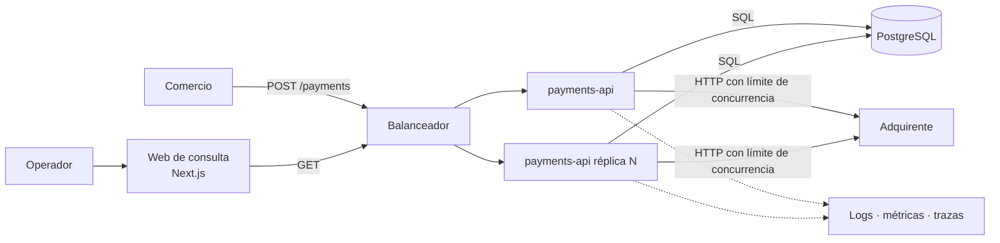
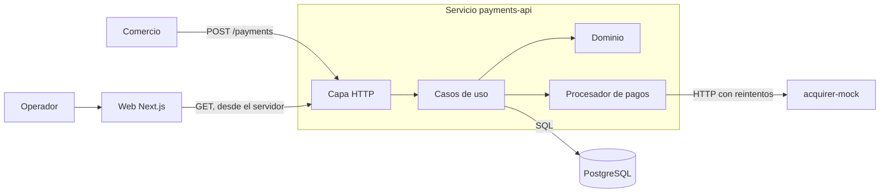
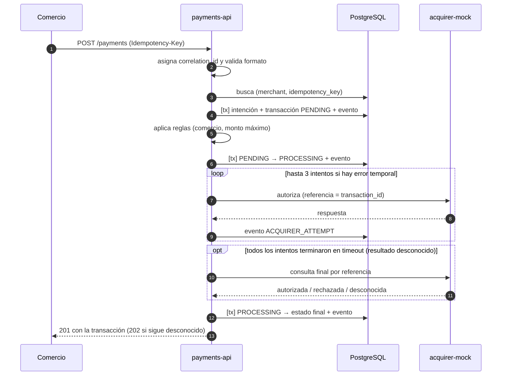
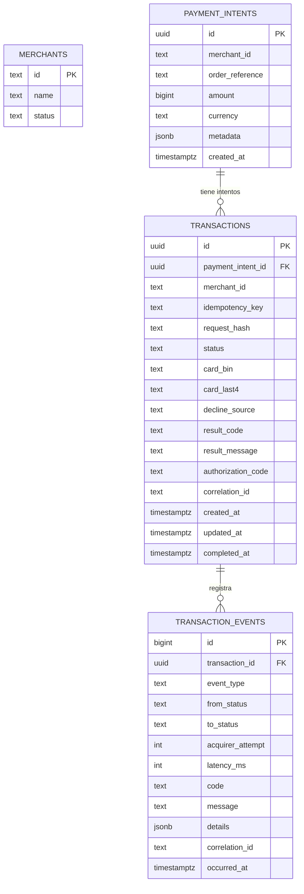

# Technical Design: Payment Processing Service

> **Cómo leer este documento**
> Se parte de la **arquitectura objetivo** (completa y escalable), se recorta al **MVP** y se define un **plan de evolución** por fases.

## Índice
1. [Resumen](#1-resumen)
2. [Principios de diseño](#2-principios-de-diseño)
3. [Arquitectura objetivo](#3-arquitectura-objetivo)
4. [MVP](#4-mvp-el-recorte)
5. [Arquitectura interna: hexagonal](#5-arquitectura-interna-hexagonal)
6. [Estructura del repositorio](#6-estructura-del-repositorio)
7. [Flujo de una transacción](#7-flujo-de-una-transacción)
8. [Modelo de datos](#8-modelo-de-datos)
9. [Contrato de la API](#9-contrato-de-la-api)
10. [Idempotencia y concurrencia](#10-idempotencia-y-concurrencia)
11. [Resiliencia ante el adquirente](#11-resiliencia-ante-el-adquirente)
12. [Observabilidad y seguridad de datos](#12-observabilidad-y-seguridad-de-datos)
13. [Acquirer Mock, frontend y pruebas](#13-acquirer-mock-frontend-y-pruebas)
14. [Preguntas abiertas](#14-preguntas-abiertas)
15. [Plan de evolución](#15-plan-de-evolución)
16. [Registro de decisiones](#16-registro-de-decisiones)
17. [Trazabilidad con el PRD](#17-trazabilidad-con-el-prd)

---

## 1. Resumen

El servicio recibe solicitudes de pago de comercios, las valida, aplica reglas de negocio, consulta a un adquirente externo y registra cada paso. Se diseña en tres capas de ambición:

| Capa | Qué es | Cuándo |
| :--- | :--- | :--- |
| **Arquitectura objetivo** | API **síncrona y sin estado**, escalable horizontalmente, observabilidad completa y autenticación por API key | Visión a futuro |
| **MVP** | API con procesamiento **síncrono** en el mismo servicio, mock del adquirente como servicio aparte, vista web básica | Lo que se construye ahora |
| **Plan de evolución** | Fases que llevan del MVP a la arquitectura objetivo sin reescribir el núcleo |

**La idea central:** el MVP y la arquitectura objetivo comparten la misma arquitectura: procesamiento **síncrono**, que es lo que exige un checkout web (el cliente aprieta pagar y espera el resultado). La evolución es **operativa** (más réplicas, más robustez), no estructural. **No hay cola ni worker**, y es una decisión deliberada (ver §3.2 y D2).

## 2. Principios de diseño

1. **Dependencias hacia adentro:** el dominio no conoce HTTP, SQL ni al adquirente.
2. **La base de datos es la fuente de verdad de las invariantes:** idempotencia y "un solo pago aprobado" se garantizan con restricciones de BD, no con código optimista.
3. **Nunca mantener una transacción de BD abierta mientras se llama a un sistema externo.**
4. **Todo cambio de estado deja rastro** (evento) y es atómico con el cambio.
5. **Datos de tarjeta fuera de disco y de logs.**
6. **Configuración por entorno**, no valores fijos en el código.
7. **API sin estado:** todo el estado vive en PostgreSQL, de modo que se escala agregando réplicas y cualquier instancia atiende cualquier petición.

## 3. Arquitectura objetivo

Es la visión completa y es **la misma arquitectura del MVP**, con más réplicas y más robustez operativa.



| Componente | Responsabilidad |
| :--- | :--- |
| **API de Pagos (sin estado)** | Valida, aplica idempotencia, procesa **en la misma petición** y expone las consultas. Todo el estado vive en PostgreSQL, así que se agregan réplicas detrás de un balanceador sin coordinación entre ellas |
| **Límite de concurrencia** | Tope de llamadas simultáneas al adquirente por instancia. Al superarlo se responde `503` con `Retry-After`, sin encolar (§11.3) |
| **PostgreSQL** | Estado, historial e idempotencia. Las restricciones únicas garantizan las invariantes aunque haya muchas réplicas |
| **Web de consulta** | Búsqueda y trazabilidad para operadores |
| **Observabilidad** | Logs estructurados, métricas y trazas correlacionadas |

### 3.1 Cómo escala

- **Sin estado local:** ni sesiones, ni cachés, ni colas en memoria. Cualquier réplica atiende cualquier petición.
- **La concurrencia entre réplicas la resuelve la base de datos** con `uq_tx_idempotency`, `uq_tx_one_active` y `uq_tx_one_approved` (§8.3).
- **El cuello de botella es el adquirente, no la API.** Go sostiene miles de conexiones esperando, por eso se limita la concurrencia hacia el adquirente en lugar de absorberla en una cola.
- **Lecturas:** réplicas de lectura de PostgreSQL para las consultas, si hace falta (Fase 2).

### 3.2 Por qué no hay cola ni worker

**`[DECISIÓN]` Procesamiento síncrono, también en la arquitectura final.**

1. **Es un checkout web interactivo:** el cliente aprieta pagar y espera el resultado en pantalla. Una cola no acelera nada y agrega un salto más, porque el worker esperaría al mismo adquirente.
2. **Exigiría complejidad sin beneficio:** el PAN no puede viajar por la cola ni guardarse (BR-10), lo que obligaría a una bóveda de tarjetas, y devolver el resultado exigiría webhooks o consultas.
3. **Lo que suele justificar una cola o procesos en segundo plano se cubre de otra forma:** los picos con límite de concurrencia, `503` y réplicas; la pérdida de conexión con idempotencia y consultas on-demand (`GET /payments/{id}`); los fallos temporales con reintentos acotados dentro de la petición.
4. **Se reconsideraría solo** si aparecen flujos **no interactivos** (cobros recurrentes, lotes, transferencias), hoy fuera de alcance.

## 4. MVP: el recorte



| Aspecto | Arquitectura objetivo | **MVP** |
| :--- | :--- | :--- |
| Procesamiento | Síncrono, en la misma petición | **Igual** |
| Respuesta del `POST` | `201` con el resultado final (`202` solo si el resultado es desconocido) | **Igual** |
| Datos de tarjeta | Solo en memoria de la petición | **Igual** |
| Adquirente | Real (varios, con enrutamiento) | **Mock** como servicio HTTP aparte |
| Instancias | N réplicas detrás de balanceador | **Una instancia + el mock** |
| Protección ante sobrecarga | Límite de concurrencia + `503` | **Igual** (semáforo simple) |
| Observabilidad | Logs + métricas + trazas | **Logs estructurados con `correlation_id`** |
| Recuperación ante fallos de conexión | On-demand (reintento idempotente o `GET /payments/{id}`) | **Igual** |
| Autenticación | API keys por comercio | Fuera de alcance |

**`[DECISIÓN]` Síncrono, en el MVP y en la arquitectura final.** Es lo que corresponde a un checkout web: el cliente aprieta pagar y espera el resultado. El costo es que la latencia del adquirente impacta la respuesta; se mitiga con timeouts, reintentos acotados y un presupuesto total de tiempo (§11), y el caso de resultado desconocido se maneja de forma explícita (§11.3).

## 5. Arquitectura interna: hexagonal

### 5.1 Capas

```
[HTTP] → [Casos de uso] → [Dominio]
              │
              └─ puertos (interfaces) ← adaptadores: Postgres, cliente del adquirente, reloj, ids
```

| Capa | Contiene | Reglas |
| :--- | :--- | :--- |
| **Dominio** | `PaymentIntent`, `Transaction`, `Merchant`, estados, máquina de estados, reglas de negocio, errores de dominio | Go puro. Sin `net/http`, `database/sql` ni tags `json`/`db` |
| **Aplicación** | Casos de uso y sus **puertos** (interfaces) | Orquesta. Define lo que necesita; no sabe cómo se implementa |
| **Adaptadores de entrada** | Handlers HTTP, DTOs, mapeo de errores a códigos HTTP | Traducen. Sin lógica de negocio |
| **Adaptadores de salida** | Repositorios Postgres, cliente HTTP del adquirente | Implementan los puertos |
| **Composition root** | `main.go` | Único lugar que conoce todas las implementaciones |

**`[DECISIÓN]` Las interfaces viven en el paquete que las consume** (`app`), no en un paquete `ports/` global. Es la práctica idiomática de Go: interfaces pequeñas y definidas por quien las usa. Refina la estructura con carpeta `ports/` que vimos en la discusión inicial.

### 5.2 Casos de uso

| Caso de uso | Entrada | Salida | Errores |
| :--- | :--- | :--- | :--- |
| `CreatePayment` | Solicitud + clave de idempotencia | Transacción | validación, conflicto, rechazo interno |
| `GetPayment` | `transaction_id` | Una transacción con su historial | `ErrNotFound` → 404 |
| `ListPayments` | Filtros + cursor | Lista de transacciones + siguiente cursor | filtro inválido → 400. Sin resultados no es error |

**`[DECISIÓN]` `GetPayment` y `ListPayments` son casos de uso separados**, con dos métodos pequeños en el repositorio (`FindByID`, `List`). Evita adaptaciones en el handler (desempaquetar un array de 1 elemento, convertir lista vacía en 404) y mantiene la semántica estándar de la API.

### 5.3 Separar aceptar de procesar

`CreatePayment` acepta y procesa, y se divide en dos responsabilidades que se ejecutan una tras otra en la misma petición:

| Responsabilidad | Qué hace |
| :--- | :--- |
| **Aceptar** (`AcceptPayment`) | Valida, aplica idempotencia, crea intención e intento en `PENDING` |
| **Procesar** (`ProcessTransaction`) | Reglas, `PROCESSING`, llamada al adquirente con reintentos, estado final |

```go
tx, err := accept.Execute(ctx, req)            // valida, idempotencia, persiste PENDING
tx, err  = process.Execute(ctx, tx.ID, card)   // reglas, adquirente, estado final
```

**`[DECISIÓN]` Se mantienen separados aunque corran juntos**, por dos motivos: cada parte se prueba por separado y el procesamiento corre con un contexto desacoplado de la petición (§7.2) para completar la transacción si el cliente corta la conexión.

## 6. Estructura del repositorio

**`[DECISIÓN]` Monorepo** con un solo `docker compose`: el backend, el mock y la web evolucionan juntos y se levantan con un comando (métrica del PRD).

```
haulmer/
├── payments-api/                     # Módulo Go: Servicio central de pagos (Hexagonal)
│   ├── cmd/
│   │   └── api/main.go               # Punto de entrada / composition root
│   ├── internal/
│   │   ├── domain/                   # Paquete plano: merchant.go, payment_intent.go, transaction.go,
│   │   │                             # card.go, amount.go, status.go, errors.go
│   │   ├── app/                      # Colocalización por Caso de Uso (Vertical Slices):
│   │   │   ├── processpayment/       # usecase.go, dto.go, ports.go, usecase_test.go
│   │   │   ├── getpayment/           # usecase.go, dto.go, ports.go, usecase_test.go
│   │   │   └── listpayments/         # usecase.go, dto.go, ports.go, usecase_test.go
│   │   └── adapters/
│   │       ├── httpapi/              # Handlers HTTP, DTOs, Middlewares, RFC 9457
│   │       ├── postgres/             # Repositorios SQL y gestión de transacciones
│   │       └── acquirer/             # Cliente HTTP hacia el adquirente externo
│   ├── migrations/                   # Scripts SQL versionados (DDL + Seeds)
│   ├── Dockerfile
│   └── go.mod
├── acquirer-mock/                    # Módulo Go: Simulador HTTP independiente del adquirente
│   ├── cmd/
│   │   └── mock/main.go              # Servidor HTTP del adquirente
│   ├── internal/                     # Lógica determinista de tarjetas, latencias y timeouts
│   ├── Dockerfile
│   └── go.mod
├── web-dashboard/                    # Next.js 15 + TypeScript: Panel web de operaciones
│   ├── src/
│   │   ├── app/                      # App Router (Páginas, Server Components)
│   │   └── components/               # Componentes UI (Timeline de eventos, Métricas, Tabla)
│   ├── Dockerfile
│   └── package.json
├── docs/
│   ├── prd.md                        # Documento de Requisitos de Producto
│   └── technical-design.md           # Diseño Técnico y Arquitectura
├── docker-compose.yml                # Orquesta postgres + acquirer-mock + payments-api + web-dashboard
├── .env.example
├── Makefile
└── README.md
```

| Elección | Decisión | Alternativa descartada |
| :--- | :--- | :--- |
| **Estructura Monorepo** | Tres servicios desacoplados por rol (`payments-api`, `acquirer-mock`, `web-dashboard`) | Carpetas genéricas `backend/` y `frontend/` (mezclan el mock externo con la API propia) |
| **Aislamiento del Mock** | Módulo Go independiente (`acquirer-mock/go.mod`) | Código del mock embebido en la API de pagos (viola la separación de un actor bancario externo) |
| **HTTP API** | Librería estándar `net/http` (enrutado por método y patrón de Go) | chi/gin: dependencias innecesarias |
| **Driver BD** | `pgx/v5` con SQL explícito | ORM: oculta el SQL justo donde importan las restricciones de concurrencia |
| **Migraciones** | SQL versionado (ej. scripts / goose) | Auto-migrate de ORM |
| **Identificadores** | UUID v7 (ordenable por tiempo) | UUID v4 (sin orden), enteros secuenciales (expuestos) |
| **Pruebas** | `go test` + `testify` | — |

## 7. Flujo de una transacción

### 7.1 Secuencia del MVP (camino feliz)



### 7.2 Pasos y decisiones

| # | Paso | Detalle |
| :--- | :--- | :--- |
| 1 | Correlación | Se toma `X-Correlation-ID` o se genera uno; viaja en el `context` y en todos los logs/eventos |
| 2 | Validación de formato | Cuerpo, campos, Luhn, vencimiento, CVV, monto, moneda, `Idempotency-Key`. **Falla → `400/422`, no se persiste nada** |
| 3 | Idempotencia | Busca por (`merchant_id`, `idempotency_key`): misma solicitud → reproduce; distinta → `409` (ver §10) |
| 4 | Persistir intento | En **una sola transacción de BD**: upsert de intención, inserción de la transacción `PENDING` y evento `TRANSACTION_CREATED` |
| 5 | Reglas de negocio | Comercio registrado y activo (BR-07), monto máximo (BR-03). Falla → `DECLINED` con motivo, **sin llamar al adquirente** |
| 6 | `PROCESSING` | Transición y evento. **Se hace commit antes de llamar al adquirente** |
| 7 | Llamada al adquirente | **Fuera de toda transacción de BD**, con timeout y reintentos (§11). Cada llamada registra un evento. Si el resultado queda desconocido, se hace una **consulta final** por referencia (§11.3) |
| 8 | Estado final | `UPDATE ... WHERE id = $1 AND status = 'PROCESSING'` más evento, en una transacción. Si no afecta filas, otro proceso ya cerró la transacción |
| 9 | Respuesta | Código HTTP según la tabla de §9.3 |

**`[DECISIÓN]` El procesamiento no se cancela si el cliente se desconecta.** Una vez enviado el pago al adquirente, abandonar a mitad dejaría la transacción en `PROCESSING` con un cobro posiblemente hecho. Por eso el procesamiento corre con un contexto desacoplado de la petición (`context.WithoutCancel`) y su propio presupuesto de tiempo.

## 8. Modelo de datos

### 8.1 Diagrama



### 8.2 Qué guarda cada tabla

| Tabla | Rol | Naturaleza |
| :--- | :--- | :--- |
| `merchants` | Comercios registrados: identificador, nombre y estado (`ACTIVE`/`INACTIVE`) | Referencia, precargada |
| `payment_intents` | **Qué se cobra**: comercio, referencia de la orden, monto, moneda y metadatos de auditoría | Inmutable tras crearse |
| `transactions` | **Cada intento**: su estado **actual** y su **resultado final** (motivo, código del adquirente) | Se actualiza al cambiar de estado |
| `transaction_events` | **Cómo se llegó ahí**: cada transición y cada llamada al adquirente | Solo se inserta, nunca se modifica |

**`[DECISIÓN]` Las tres tablas son complementarias, no redundantes.**
- `transactions` responde "cómo quedó" y sirve las consultas y la reproducción idempotente sin recorrer eventos.
- `transaction_events` responde "qué pasó y cuándo": reintentos al adquirente, tiempos, errores intermedios.
- La respuesta final del adquirente vive en `transactions` (resultado) y la de **cada llamada** en `transaction_events`. Es una duplicación deliberada.

> [!NOTE]
> **Dos "intentos" distintos.** Un *intento de pago* es una fila de `transactions`. Un *intento de llamada al adquirente* es cada reintento dentro de una transacción y se guarda en `transaction_events.acquirer_attempt`. En el código se nombra este último `acquirer_attempt` para no confundirlos.

### 8.3 Esquema

```sql
CREATE TABLE merchants (
    id     TEXT PRIMARY KEY,
    name   TEXT NOT NULL,
    status TEXT NOT NULL CHECK (status IN ('ACTIVE', 'INACTIVE'))
);

CREATE TABLE payment_intents (
    id              UUID PRIMARY KEY,
    merchant_id     TEXT        NOT NULL,       -- sin FK a propósito (ver nota)
    order_reference TEXT        NOT NULL,
    amount          BIGINT      NOT NULL CHECK (amount > 0),  -- CLP, sin decimales
    currency        TEXT        NOT NULL CHECK (currency = 'CLP'),
    metadata        JSONB       NOT NULL DEFAULT '{}'::jsonb, -- info complementaria para auditoría/debugging
    created_at      TIMESTAMPTZ NOT NULL DEFAULT now(),
    UNIQUE (merchant_id, order_reference)
);

CREATE TABLE transactions (
    id                 UUID PRIMARY KEY,
    payment_intent_id  UUID        NOT NULL REFERENCES payment_intents (id),
    merchant_id        TEXT        NOT NULL,    -- copia de la intención, para los índices únicos
    idempotency_key    TEXT        NOT NULL,
    request_hash       TEXT        NOT NULL,
    status             TEXT        NOT NULL CHECK (status IN
                         ('PENDING','PROCESSING','APPROVED','DECLINED','FAILED')),
    card_bin           TEXT        NOT NULL,    -- primeros 6 dígitos
    card_last4         TEXT        NOT NULL,
    decline_source     TEXT        CHECK (decline_source IN ('INTERNAL','ACQUIRER')),
    result_code        TEXT,
    result_message     TEXT,
    authorization_code TEXT,
    correlation_id     TEXT        NOT NULL,
    created_at         TIMESTAMPTZ NOT NULL DEFAULT now(),
    updated_at         TIMESTAMPTZ NOT NULL DEFAULT now(),
    completed_at       TIMESTAMPTZ
);

-- Idempotencia: una clave por comercio, a nivel de BD
CREATE UNIQUE INDEX uq_tx_idempotency ON transactions (merchant_id, idempotency_key);

-- BR-11: a lo sumo un intento aprobado por intención
CREATE UNIQUE INDEX uq_tx_one_approved ON transactions (payment_intent_id)
    WHERE status = 'APPROVED';

-- A lo sumo un intento en curso por intención (evita cobrar dos veces en paralelo)
CREATE UNIQUE INDEX uq_tx_one_active ON transactions (payment_intent_id)
    WHERE status IN ('PENDING', 'PROCESSING');

-- Consultas
CREATE INDEX ix_tx_list ON transactions (merchant_id, status, created_at DESC, id DESC);
CREATE INDEX ix_tx_created ON transactions (created_at DESC, id DESC);

CREATE TABLE transaction_events (
    id               BIGINT GENERATED ALWAYS AS IDENTITY PRIMARY KEY,
    transaction_id   UUID        NOT NULL REFERENCES transactions (id),
    event_type       TEXT        NOT NULL CHECK (event_type IN
                       ('TRANSACTION_CREATED','STATUS_CHANGED','ACQUIRER_ATTEMPT')),
    from_status      TEXT,
    to_status        TEXT,
    acquirer_attempt INT,
    latency_ms       INT,
    code             TEXT,
    message          TEXT,
    details          JSONB,
    correlation_id   TEXT        NOT NULL,
    occurred_at      TIMESTAMPTZ NOT NULL DEFAULT now()
);
CREATE INDEX ix_events_tx ON transaction_events (transaction_id, id);
```

### 8.4 Decisiones del modelo

| Decisión | Justificación |
| :--- | :--- |
| **Monto `BIGINT` en CLP** | El peso chileno no tiene decimales (BR-01). Nunca flotantes |
| **`merchant_id` sin FK en `payment_intents`** | Un comercio inexistente debe poder registrarse como `DECLINED` (BR-07). Se acepta perder la integridad referencial a cambio de la trazabilidad |
| **`merchant_id` copiado en `transactions`** | Un índice único no puede abarcar dos tablas. Se necesita (`merchant_id`, `idempotency_key`) en la misma tabla |
| **`uq_tx_one_approved`** | Garantiza BR-11 en la base de datos, aunque dos peticiones se crucen |
| **`uq_tx_one_active`** | Sin este índice, dos intentos paralelos de la misma intención podrían ser aprobados por el adquirente antes de que el índice anterior los detenga. Esto **cierra el doble cobro** |
| **Sin tabla de idempotencia aparte** | `transactions` ya guarda la clave y el resultado. Reproducir una respuesta es leer esa fila |
| **PAN: solo `card_bin` + `card_last4`; sin CVV** | BR-10 |
| **`request_hash` sin datos sensibles** | Se calcula sobre comercio, orden, monto, moneda y BIN/últimos 4/vencimiento. Un hash del PAN completo sería vulnerable a fuerza bruta |
| **`transaction_events` solo-inserción** | Es un registro de auditoría. Se refuerza con permisos (`REVOKE UPDATE, DELETE`) o un trigger |
| **`details` JSONB sin datos de tarjeta** | Flexibilidad para el detalle del adquirente; se sanea antes de guardarlo |
| **`payment_intents.metadata` JSONB** | Permite registrar datos contextuales (email del cliente, descripción del carrito) para facilitar auditoría y debugging sin alterar el esquema |
| **TTL de 5 minutos en `PROCESSING`** | Si una transacción queda en `PROCESSING` por más de 5 minutos (caída abrupta de instancia Go/pod), se considera expirada y transiciona a `FAILED` con motivo `PROCESSING_TIMEOUT`, liberando la intención |

> [!NOTE]
> **Cambios que el modelo ya anticipa:** monto máximo por comercio (una columna en `merchants`), más monedas (se amplía el `CHECK`), particionar `transaction_events` por fecha cuando crezca, y varias aprobaciones por intención (pagos parciales) quitando `uq_tx_one_approved`.

## 9. Contrato de la API

### 9.1 `POST /payments`

**Encabezados**

| Encabezado | Obligatorio | Descripción |
| :--- | :---: | :--- |
| `Idempotency-Key` | Sí | Clave única por solicitud de intento, definida por el comercio |
| `X-Correlation-ID` | No | Si no viene, se genera. Se devuelve siempre en la respuesta |
| `Content-Type` | Sí | `application/json` |

**Cuerpo**

```json
{
  "merchant_id": "m_1001",
  "order_reference": "ORD-2026-000123",
  "amount": 25990,
  "currency": "CLP",
  "card": {
    "number": "4242424242424242",
    "expiry_month": 12,
    "expiry_year": 2028,
    "cvv": "123",
    "holder_name": "Ana Pérez"
  }
}
```

**Respuesta** (nunca incluye PAN completo ni CVV)

```json
{
  "id": "0192f3a4-7c1e-7a55-9d0e-3b1f6a2c8e11",
  "payment_intent_id": "0192f3a4-7c1d-7b02-8a41-5c9d2e7f1a30",
  "merchant_id": "m_1001",
  "order_reference": "ORD-2026-000123",
  "amount": 25990,
  "currency": "CLP",
  "status": "APPROVED",
  "card": { "bin": "424242", "last4": "4242" },
  "result": { "source": "ACQUIRER", "code": "00", "message": "Approved", "authorization_code": "A1B2C3" },
  "correlation_id": "c9d1e0f2-...",
  "created_at": "2026-10-23T01:50:00Z",
  "completed_at": "2026-10-23T01:50:01Z"
}
```

### 9.2 Consultas

| Endpoint | Respuesta |
| :--- | :--- |
| `GET /payments/{transaction_id}` | Un objeto: la transacción **con su historial** (`events`). `404` si no existe |
| `GET /payments?merchant_id=&status=&order_reference=&limit=&cursor=` | `{ "data": [...], "next_cursor": "..." }`. Todos los filtros son opcionales. Sin resultados: `200` con `data: []` |

- **Paginación por cursor** (clave compuesta `created_at, id`): estable ante inserciones y eficiente. `limit` por defecto 20, máximo 100.
- **`[SUPUESTO]`** Los filtros son opcionales para que la web de operadores pueda listar sin acotar por comercio.
- El listado devuelve la transacción **sin** `events`; el detalle los incluye.

### 9.3 Códigos de respuesta

| Situación | HTTP | `code` |
| :--- | :---: | :--- |
| Intento procesado, aprobado, rechazado por el adquirente o fallido | `201` | (el resultado va en `status`) |
| Reproducción idempotente de una solicitud ya procesada | `200` | (+ encabezado `Idempotent-Replayed: true`) |
| Resultado **desconocido** tras la consulta final: la transacción queda en `PROCESSING` | `202` | (+ `Location` y `Retry-After`; el comercio consulta `GET /payments/{id}`) |
| JSON mal formado, campo desconocido o `Idempotency-Key` ausente | `400` | `invalid_request` |
| Datos inválidos (Luhn, vencimiento, CVV, monto, moneda) | `422` | `validation_failed` |
| Comercio no registrado o inactivo (se registra `DECLINED`) | `422` | `merchant_not_allowed` |
| Monto sobre el máximo (se registra `DECLINED`) | `422` | `amount_limit_exceeded` |
| Misma `Idempotency-Key` con solicitud distinta | `409` | `idempotency_key_reused` |
| Solicitud original aún en proceso | `409` | `request_in_progress` |
| Intención ya pagada | `409` | `order_already_paid` |
| Intención con otro intento en curso | `409` | `order_attempt_in_progress` |
| Misma orden con monto/moneda distintos | `409` | `order_mismatch` |
| Instancia saturada (límite de concurrencia hacia el adquirente) | `503` | `service_overloaded` (+ `Retry-After`) |
| Error interno inesperado | `500` | `internal_error` |

**Formato de error:** `application/problem+json` (RFC 9457) con `type`, `title`, `status`, `code`, `detail`, `correlation_id` y, cuando se registró una transacción (rechazos internos), `transaction_id`.

**`[DECISIÓN]` El código HTTP describe la solicitud; el negocio va en `status`.**
- Un rechazo del **adquirente** es un resultado de negocio válido (la tarjeta del cliente fue rechazada): `201` con `status: DECLINED`.
- Un rechazo **interno** (comercio no válido, monto máximo) es un problema de la solicitud que el comercio puede corregir: `422`, aunque igualmente queda registrado.
- `FAILED` también se responde `201`: la transacción existe y su estado es explícito (R10).
- `202` solo cuando el resultado es **desconocido** (no se obtuvo ni la respuesta ni la consulta final del adquirente): la transacción queda en `PROCESSING` y el comercio consulta `GET /payments/{id}`. No se usa webhook: la consulta es suficiente para este flujo.

## 10. Idempotencia y concurrencia

**`[DECISIÓN]` Encabezado `Idempotency-Key` obligatorio, con unicidad garantizada por la base de datos.** Es la convención de la industria y deja el cuerpo libre para el contenido del pago.

### 10.1 Reglas

| Caso | Resultado |
| :--- | :--- |
| Clave nueva | Se procesa normalmente |
| Misma clave, **misma** solicitud (`request_hash` idéntico), transacción terminada | Se devuelve el resultado original con `200` e `Idempotent-Replayed: true`. No se llama al adquirente |
| Misma clave, **misma** solicitud, transacción en curso | `409 request_in_progress`. En el frontend, el botón de pago se deshabilita síncronamente al hacer clic (`isSubmitting = true`). Si una petición duplicada recibe `409`, la interfaz mantiene el spinner activo en espera de la respuesta de la petición original en vuelo |
| Misma clave, solicitud **distinta** (`request_hash` difiere) | `422/409 idempotency_key_reused`. Protege contra colisiones de clave y errores de comercios que reutilizan UUIDs con montos u órdenes diferentes |
| Transacción `FAILED` + misma clave | Se devuelve el mismo `FAILED` original (no se reintenta con la misma clave) |
| Nuevo intento sobre la misma orden (ej. cambio de tarjeta por fondos insuficientes) | Requiere **clave nueva** y la misma `order_reference` |
| Transacción atascada en `PROCESSING` > 5 minutos | Se activa el **TTL de expiración**: pasa automáticamente a `FAILED` (`PROCESSING_TIMEOUT`), liberando el índice `uq_tx_one_active` |

### 10.2 Cómo se garantiza ante concurrencia

1. **Cálculo del hash de integridad:** la API calcula `request_hash = SHA256(merchant_id + order_reference + amount + currency + card_bin + card_last4)`.
2. Se intenta insertar la transacción en BD. **La restricción única `uq_tx_idempotency` decide quién gana atómicamente**; no hay un "buscar y luego insertar" vulnerable a carreras en $t_0$.
3. Si la inserción falla por duplicado (`uq_tx_idempotency`), se lee la fila existente:
   - Si `request_hash` difiere $\rightarrow$ `409 idempotency_key_reused` / `422`.
   - Si está en `PROCESSING` y dentro del TTL $\rightarrow$ `409 request_in_progress`.
   - Si ya está terminada $\rightarrow$ respuesta idempotente `200 OK` con `Idempotent-Replayed: true`.
4. `uq_tx_one_active` impide dos intentos simultáneos sobre la misma orden, y `uq_tx_one_approved` impide dos aprobaciones.
5. Violaciones de estos índices se traducen a los `409` correspondientes en formato RFC 9457, nunca a `500`.

### 10.3 Dos identificadores, dos funciones

| Identificador | Identifica | Sirve para |
| :--- | :--- | :--- |
| `Idempotency-Key` | Una **solicitud de intento** | Reintentar tras un timeout sin duplicar |
| `order_reference` | Una **intención de pago** | Agrupar los intentos de un mismo cobro |

## 11. Resiliencia ante el adquirente

### 11.1 Qué se reintenta

| Respuesta del adquirente | ¿Reintento? | Resultado final |
| :--- | :---: | :--- |
| Aprobado | No | `APPROVED` |
| Rechazo de negocio (fondos insuficientes, etc.) | **No** | `DECLINED` |
| `5xx`, `429` (el adquirente indica que **no** autorizó) | **Sí** | Si se agotan: `FAILED` |
| Timeout o conexión cortada (**resultado desconocido**: pudo haber autorizado) | **Sí** | Si se agotan: consulta final por referencia (§11.3) |
| Respuesta inválida o no interpretable | Sí | Si se agota: se trata como resultado desconocido |

### 11.2 Política (configurable)

| Parámetro | Valor inicial | Variable |
| :--- | :--- | :--- |
| Timeout por llamada | 2 s | `ACQUIRER_TIMEOUT` |
| Intentos máximos | 3 | `ACQUIRER_MAX_ATTEMPTS` |
| Espera entre intentos | Exponencial con *jitter* (base 200 ms) | `ACQUIRER_BACKOFF_BASE` |
| Presupuesto total por petición | ~10 s | `PROCESSING_BUDGET` |
| Llamadas simultáneas al adquirente por instancia | 50 | `ACQUIRER_MAX_INFLIGHT` |

### 11.3 Garantías para no cobrar dos veces

- **Referencia idempotente hacia el adquirente:** cada llamada envía el `transaction_id` como referencia, de modo que un reintento tras un timeout **no genera una segunda autorización** en el adquirente.
- **Consulta final ante resultado desconocido:** un timeout o una conexión cortada no prueban que el adquirente no autorizó. Si los reintentos terminan solo con resultados desconocidos, se consulta al adquirente por la referencia en la misma petición: si autorizó, `APPROVED`; si rechazó, `DECLINED`; si no conoce la referencia, `FAILED` (es seguro: no existe autorización). Si la consulta también falla, la transacción queda en `PROCESSING` y se responde `202`.
- **Cierre atómico:** el estado final solo se aplica si la transacción sigue en `PROCESSING`.
- **Recuperación on-demand (sin procesos en segundo plano):** En un checkout web, las acciones son siempre iniciadas por el usuario o el comercio (Customer-Initiated). Si la conexión se interrumpió o hubo un timeout de red, el comercio simplemente reenvía la petición con la misma `Idempotency-Key` o consulta `GET /payments/{id}`. La API verifica el estado actual en BD o consulta al adquirente on-demand. No existen procesos en segundo plano (crons/demonios) ejecutando cobros o mutando transacciones de espaldas al usuario.
- **Protección ante sobrecarga:** un semáforo limita las llamadas simultáneas al adquirente por instancia (`ACQUIRER_MAX_INFLIGHT`). Si se llena, la petición se rechaza **antes de crear la transacción** con `503 service_overloaded` y `Retry-After`. No se encola: el comercio reintenta con la misma clave de idempotencia.

**Evolución:** *circuit breaker* para dejar de golpear a un adquirente caído, y enrutamiento entre adquirentes (Fase 2).

## 12. Observabilidad y seguridad de datos

### 12.1 Logs y correlación

| Aspecto | Diseño |
| :--- | :--- |
| Formato | JSON estructurado con `log/slog` |
| `correlation_id` | Se asigna en la entrada (o se toma de `X-Correlation-ID`), viaja en el `context`, se escribe en **cada log**, en `transactions` y en `transaction_events`, y se devuelve en la respuesta |
| Campos comunes | `correlation_id`, `transaction_id`, `payment_intent_id`, `merchant_id`, `status`, `acquirer_attempt`, `duration_ms` |
| Niveles | `INFO` en transiciones de estado, `WARN` en reintentos, `ERROR` en fallos |
| Del adquirente | `correlation_id` y `transaction_id` se envían como encabezados para que el mock los registre también |

Con un `correlation_id` se puede reconstruir el recorrido completo en logs, y con un `transaction_id` el recorrido en base de datos (R13, R14).

### 12.2 Seguridad de datos de tarjeta (BR-10)

| Dato | En memoria | En BD | En logs | En respuesta |
| :--- | :---: | :---: | :---: | :---: |
| PAN completo | Sí (solo durante la petición) | **No** | **No** | **No** |
| BIN + últimos 4 | Sí | Sí | Sí (solo últimos 4) | Sí |
| CVV | Sí (solo durante la petición) | **No** | **No** | **No** |

- El tipo `Card` implementa `slog.LogValuer` y `String()` para **redactarse solo**: aunque alguien lo loguee por error, no sale el PAN.
- Cuerpos de petición **nunca** se loguean completos.
- El decodificador JSON rechaza campos desconocidos y limita el tamaño del cuerpo.
- Una prueba automatizada verifica que los logs de un pago no contienen el PAN ni el CVV (métrica del PRD).

### 12.3 Operación

- `GET /healthz` (vivo) y `GET /readyz` (BD disponible).
- Apagado ordenado: se deja de aceptar peticiones y se espera a las que están en curso.
- Evolución: métricas (latencia, tasa de aprobación, reintentos) y trazas distribuidas con OpenTelemetry.

## 13. Acquirer Mock, frontend y pruebas

### 13.1 Acquirer Mock

**`[DECISIÓN]` Servicio HTTP independiente** (`cmd/acquirer-mock`) y no un doble en memoria. Así las llamadas reales (timeouts, `5xx`, latencia) se ejercitan igual que con un adquirente real, y es una pieza más para mostrar en el README.

**Endpoints:** `POST /authorizations` (autoriza) y `GET /authorizations/{reference}` (consulta: devuelve la autorización registrada o `404` si la referencia no existe; la usa la consulta final ante timeouts).

**Comportamiento determinista según el PAN** (todos pasan Luhn):

| PAN de prueba | Comportamiento | Resultado esperado |
| :--- | :--- | :--- |
| `4242424242424242` | Aprueba | `APPROVED` |
| `4000000000009995` | Rechaza: fondos insuficientes (código `51`) | `DECLINED` |
| `4000000000000119` | Siempre responde `503` | `FAILED` tras 3 intentos |
| `4000000000000341` | Falla (`503`) los 2 primeros intentos y aprueba el 3.º | `APPROVED` tras reintentos |
| `4000000000000101` | No responde y **no registra** la autorización | `FAILED`: tras los timeouts, la consulta final confirma que no hay autorización |
| `4000000000000259` | Autoriza pero **la respuesta se pierde** (excede el timeout) | `APPROVED`: la consulta final recupera la autorización |

El mock es **idempotente por referencia**: la misma referencia devuelve la misma respuesta, y cuenta los intentos por referencia para el caso del PAN `…0341`. Cualquier otro PAN válido aprueba.

### 13.2 Web Dashboard (`web-dashboard/`)

**`[DECISIÓN]` La web consume la API, desde el servidor de Next.js**, no la base de datos directamente. Mantiene un solo punto de reglas y contrato, y la web no se acopla al esquema. Las llamadas a la API se hacen en *Server Components*, así la URL interna de la API no llega al navegador.

| Pantalla | Contenido |
| :--- | :--- |
| Listado | Filtros por comercio y estado, paginación por cursor |
| Detalle | Datos de la transacción y **línea de tiempo** de eventos (transiciones y llamadas al adquirente) |

Es una vista de consulta: **no** crea pagos. Sin autenticación (fuera de alcance).

### 13.3 Estrategia de pruebas

| Nivel | Qué prueba | Herramienta |
| :--- | :--- | :--- |
| **Unitarias de dominio** | Máquina de estados (transiciones válidas e inválidas), Luhn, vencimiento, monto máximo, enmascarado | `go test` |
| **Unitarias de casos de uso** | Flujos con repositorios y adquirente falsos: aprobación, rechazo, errores temporales, idempotencia | `go test` + `testify` |
| **Integración de BD** | Restricciones únicas, transiciones atómicas, paginación | PostgreSQL real (contenedor) |
| **Concurrencia** | N peticiones simultáneas con la misma clave → 1 transacción; dos intentos paralelos sobre una orden → 1 en curso | `go test -race` |
| **HTTP** | Handlers, códigos y formato de error | `httptest` |
| **Extremo a extremo** | Los PAN de prueba contra el stack levantado | `docker compose` |
| **Seguridad** | Los logs no contienen PAN ni CVV | Prueba automatizada |

### 13.4 Configuración (variables de entorno)

| Variable | Descripción |
| :--- | :--- |
| `HTTP_ADDR` | Dirección de escucha de la API |
| `DATABASE_URL` | Cadena de conexión a PostgreSQL |
| `ACQUIRER_BASE_URL` | URL del adquirente |
| `ACQUIRER_TIMEOUT`, `ACQUIRER_MAX_ATTEMPTS`, `ACQUIRER_BACKOFF_BASE`, `PROCESSING_BUDGET` | Política de resiliencia (§11.2) |
| `ACQUIRER_MAX_INFLIGHT` | Máximo de llamadas simultáneas al adquirente por instancia (§11.3) |
| `PAYMENT_MAX_AMOUNT_CLP` | Monto máximo por transacción (BR-03). **Valor por definir, ver Q4 del PRD** |
| `LOG_LEVEL` | Nivel de log |

Se carga en el `main` y se inyecta; el dominio no lee el entorno.

## 14. Decisiones de arquitectura ratificadas

| # | Punto Auditado | Decisión Ratificada | Justificación Técnica |
| :--- | :--- | :--- | :--- |
| **T1** | Códigos HTTP en rechazos | **`422` rechazos internos, `201` rechazos del adquirente** | Un rechazo interno (monto, comercio inactivo) es un error de la solicitud; el rechazo del adquirente es un resultado de negocio válido del intento |
| **T2** | Herramienta de migraciones | **`goose` o scripts SQL versionados embebidos** | Simplicidad operativa, binario autocontenido y sin dependencias externas |
| **T3** | Integridad referencial de comercios | **`merchant_id` sin FK estricta en `payment_intents`** | Permite persistir y auditar transacciones con `DECLINED` por comercio no registrado (BR-07) |
| **T4** | Política de reintentos | **3 intentos, timeout 2s, backoff exponencial desde 200ms** | Límite acotado para no degradar la experiencia en un checkout síncrono |
| **T5** | PANs de prueba del mock | **Los 6 PANs deterministas propuestos** | Cubren éxito, saldo insuficiente, errores 503 recuperables y no recuperables, y timeouts |
| **T6** | Integración del Frontend | **Consumo de la API desde Next.js Server Components** | Seguridad (la URL interna no se expone al cliente) y desacople del esquema SQL |
| **T7** | Procesos en segundo plano (crons) | **Descartados deliberadamente; recuperación 100% On-Demand** | No se almacenan tarjetas (PCI); la recuperación se gatilla por reintento con `Idempotency-Key` o consulta `GET /payments/{id}` |
| **T8** | Semáforo de concurrencia | **50 llamadas simultáneas en vuelo por instancia** | Protege al adquirente de saturación; responde `503` con `Retry-After` sin encolar |
| **T9** | Idioma del proyecto | **Código, identificadores y commits en inglés; Docs y UI en español** | Estándar global de ingeniería con interfaz amigable |
| **T10** | Manejo de resultado desconocido | **`202 Accepted` con estado `PROCESSING` y TTL de 5 minutos** | Evita cobros huérfanos; tras 5 minutos sin resolución expira a `FAILED` (`PROCESSING_TIMEOUT`) |
| **T11** | Integridad de Idempotencia | **Hash SHA-256 (`request_hash`) persistido en cada transacción** | Detección atómica de colisión o manipulación de parámetros con la misma clave (`409/422`) |
| **T12** | Aislamiento Multitenant | **`X-Merchant-ID` validado y filtrado en SQL para MVP; API Keys + RLS a futuro** | Alcance pragmático para MVP con costuras listas para evolucionar en Fase 1 |

## 15. Plan de evolución

La arquitectura no cambia entre fases: se agregan réplicas y robustez operativa.

| Fase | Objetivo | Qué incluye |
| :--- | :--- | :--- |
| **0. MVP** | Cumplir el desafío | Todo lo de §4: API síncrona, 3 tablas + comercios, idempotencia, reintentos y consulta final, límite de concurrencia, mock, logs correlacionados, pruebas, web básica, Docker |
| **1. Robustez** | Operar con confianza | Monto máximo por comercio, métricas, trazas con OpenTelemetry, autenticación por API key |
| **2. Escala** | Crecer en volumen y adquirentes | Réplicas de la API detrás de un balanceador, *circuit breaker*, varios adquirentes con enrutamiento, particionado de eventos, réplicas de lectura, limitación de tasa por comercio |

**Costuras que ya están en el MVP:** API sin estado (más réplicas sin cambios), puerto del adquirente (varios adquirentes), `merchants` (reglas por comercio), `transaction_events` particionable y consulta por referencia al mock para resolución on-demand.

**Lo que no se hará, y cuándo reconsiderarlo:** cola, worker, bóveda de tarjetas y webhooks. Solo se reevaluarían si aparecen flujos **no interactivos** (cobros recurrentes, lotes, transferencias), hoy fuera de alcance (§3.2).

## 16. Registro de decisiones

| # | Decisión | Alternativas | Justificación |
| :--- | :--- | :--- | :--- |
| D1 | Arquitectura hexagonal con interfaces en el consumidor | Capas globales; sin capas | Dominio probable sin infraestructura; idiomático en Go |
| D2 | Procesamiento síncrono, también en la arquitectura final | Cola + worker (asíncrono) | Checkout web interactivo: una cola no acelera la respuesta y exige bóveda de tarjetas y webhooks. Los picos se manejan con límite de concurrencia y réplicas |
| D3 | Web consume la API desde el servidor de Next.js | Next.js lee la BD directamente | Un solo punto de reglas y contrato; sin acople al esquema |
| D4 | `Idempotency-Key` en encabezado + restricción única en BD | Id en el cuerpo; verificación en código | Estándar de la industria; la BD resuelve la carrera |
| D5 | Tablas `payment_intents` / `transactions` / `transaction_events` | Solo `transactions`; eventos como JSON | Separa qué se cobra, cómo terminó y cómo llegó ahí |
| D6 | `uq_tx_one_active` + `uq_tx_one_approved` | Control en código | Imposible violar la regla de un solo cobro, incluso con concurrencia |
| D7 | Sin transacción de BD abierta durante la llamada al adquirente | Una transacción global | Evita bloqueos largos y conexiones agotadas |
| D8 | Procesamiento desacoplado de la cancelación del cliente | Cancelar con la petición | Evita transacciones atascadas con cobro posible |
| D9 | Mock como servicio HTTP independiente, determinista por PAN | Doble en memoria | Ejercita el cliente real; pruebas reproducibles |
| D10 | `net/http` estándar y `pgx` con SQL explícito | chi/gin; ORM | Menos dependencias; el SQL es visible donde importan las restricciones |
| D11 | Monto `BIGINT` en CLP | Decimales/flotantes | CLP no tiene decimales |
| D12 | Errores `application/problem+json` | Formato propio | Estándar (RFC 9457) |
| D13 | Monorepo con `docker compose` único | Repos separados | Se levanta con un comando |
| D14 | PAN solo en la memoria de la petición | Guardar cifrado; bóveda | Cumple BR-10; sin cola no hay necesidad de persistirlo |
| D15 | Límite de concurrencia hacia el adquirente y `503` con `Retry-After` | Encolar; sin límite | Protege al adquirente y evita acumular espera; el comercio reintenta con la misma clave |
| D16 | Consulta final por referencia ante resultado desconocido | Declarar `FAILED` tras agotar los reintentos | Un timeout no prueba que no se autorizó; evita declarar "no cobrado" un pago que sí se cobró |

## 17. Trazabilidad con el PRD

| Requerimiento | Dónde se resuelve |
| :--- | :--- |
| R1–R3 Creación y resultado | §7, §9.1 |
| R4–R6 Transacción, reglas, adquirente | §7.2, §8, §11 |
| R7, R8 Idempotencia | §10 |
| R9, R10 Errores temporales y `FAILED` | §11 |
| R11, R12, R15 Consulta y paginación | §9.2 |
| R13, R14 Historial y logs | §8 (`transaction_events`), §12.1 |
| R16, R17 Vista web | §13.2 |
| R18, R19 Acquirer Mock | §13.1 |
| R20 Reintentar una intención | §8 (`payment_intents`), §10.3 |
| BR-01…BR-11 | §8.3 (restricciones), §7.2, §10 |
| BR-10 Datos de tarjeta | §12.2 |
| Métrica: levantar con un comando | §6, `docker-compose.yml` |
